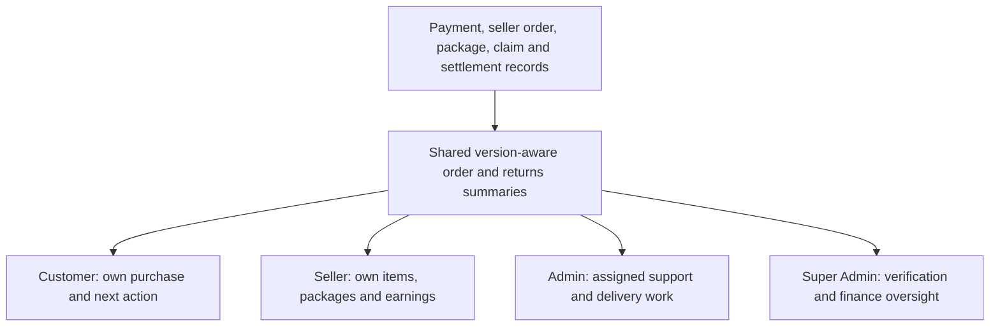

# Cross-role commerce integration audit — 18 November 2026

## Decision and scope

The marketplace shares a Go application and PostgreSQL database, and substantial
payment, fulfillment, policy and finance controls already exist. The material
gap is that several customer and operator screens still project the historical
workflow while the newer item/package workflow has separate screens and records.
Shared storage alone does not make these projections consistent.

Resolve the confirmed projection/document gaps below before opening general
checkout. Continue with a deliberately restricted genuine pilot after its setup
and activation checks. Do not infer live-delivery readiness from a green unit
test, an old delivered order, or the presence of dashboard links.

Scope: product approval/readiness, checkout activation, captured payment,
customer and seller order views, independent packages, return/claim/refund views,
company support and settlement visibility. Evidence is current source inspection,
graph discovery with source fallback, aggregate read-only production queries, and
local browser verification of the navigation repair. This is not an exhaustive
security, tax, performance or every-screen visual audit. No customer orders,
payments, refunds, bookings, legal profiles or production launch switches were
changed for this audit.

## Production evidence

Production was inspected at revision
`1e8fd22cfe4ddb366913e935fbd986301943b57b` before the navigation repair release.
Queries used read-only PostgreSQL transactions and a ten-second statement limit.
No personal details, credentials or private evidence are reproduced here.

| Observation | Current result | Meaning |
| --- | --- | --- |
| Approved active options / active sellers | 8 / 2 | Catalog approval is distinct from checkout readiness. |
| Options satisfying setup readiness | 1 | Remaining options need specific setup work. This does not enable checkout. |
| Options with missing parcel measurements | 7 | Real packed weight and all three dimensions are required. |
| Options blocked by a missing seller invoice profile | 5 | Complete the shared seller profile once; this is not five separate seller profiles. |
| Options with missing/incompatible tax readiness | 7 | Verify each option's actual classification and tax treatment. |
| Options without return classification | 6 | Verify classification per option. |
| Options missing a verified pickup mapping | 0 | Both active sellers have mapped pickup profiles. |
| Runtime checkout / shipment bookings | false / false | Production is deliberately paused. |
| Historical orders | 4, all workflow version 1 | One delivered, one cancelled and two payment-failed orders. |
| Workflow version 2 orders / modern packages / seller invoices | 0 / 0 / 0 | There is no genuine end-to-end proof of the newer workflow yet. |
| Modern returns / modern refunds / open delivery cases | 0 / 0 / 0 | Empty queues do not prove exception handling. |
| Settlement records / failed marketplace jobs | 1 / 0 | A settlement record alone does not establish a bank-confirmed payout rehearsal. |

Counts are a point-in-time observation and can change as the owner completes
setup. Missing-field counts overlap and must not be added together.

## Confirmed findings

Severity 3 means a major task/consistency problem; severity 2 means material
friction. The live activation and physical rehearsal rows are operational gaps,
not claims that the provider integration code is absent.

| ID / severity | Evidence and concrete consequence | Required correction and acceptance check |
| --- | --- | --- |
| A1 / 3 — Returns queues omit the newer records | Customer `customerReturns` reads `return_requests` and `payment_refunds`; company `adminReturns`, seller `sellerReturns` and seller return counters also read the historical tables. New Fulfillment separately reads `marketplace_returns`, `marketplace_claims` and `marketplace_refunds`. A new claim can be actionable in Fulfillment while the usual Returns screen/counter has no corresponding row. Sources: `internal/web/handlers/live_storefront.go:1591`, `internal/web/handlers/live_portal.go:1357`, `internal/web/handlers/live_portal.go:2434`, `internal/web/handlers/seller_insights.go:46`, `internal/adapters/postgres/marketplace.go:153`, `internal/adapters/postgres/return_policy.go`. | Create one role-scoped returns/claims projection spanning both versions, with record type and stable identity. Make customer, seller and company queues/counts consume it. Preserve historical policy and private-evidence sharing boundaries. Check one item claim appears for its customer, its seller and company staff; an unrelated seller sees nothing. |
| A2 / 3 — Main order/payment summaries omit modern item outcomes | `customerOrderView` derives refund status from `payment_refunds`; `GetOrder` reads the payment attempt status without its refunded amount, and order-item views use original quantity/line total without cancelled/refunded quantities. Modern Fulfillment derives `partially_refunded` from the actual refunded amount and exposes item cancellation/refund quantities. Sources: `internal/web/handlers/live_storefront.go:1526`, `internal/adapters/postgres/commerce_repository.go:1251`, `internal/adapters/postgres/marketplace.go:135`, `internal/web/handlers/live_portal.go:642`. | Keep original purchase totals, but also show cancelled/refunded quantities, refund totals and remaining amount using one shared order projection. A partial refund must appear consistently on My Orders, order detail, Payments, seller detail and company finance. Do not overwrite the original invoice or equate refund approval with provider completion. |
| A3 / 3 — Seller documents compete with official documents | `SellerOrderDetailRegion` offers `Print invoice`, a basic subtotal document, and can offer `Print shipping label` whenever `Shiprocket == nil`. Modern detail deliberately skips the legacy `loadShiprocket`, so nil can mean the modern workflow. Its official invoice and carrier label are obtained in Fulfillment instead. Sources: `web/selleradmin/portal_views.templ:495`, `internal/web/handlers/live_portal.go:681`, `internal/adapters/postgres/marketplace_invoices.go:17`, `web/components/marketplace.templ`. | For new orders, use the immutable seller invoice/credit-note PDFs and the package's real carrier label. Keep a packing slip separate. Disable label download until a genuine label exists. Rename historical basic documents truthfully. Verify both seller entry points download the same invoice bytes/number and the same AWB-specific carrier label. |
| A4 / 3 — Seller order stages lose modern distinctions | New actions write `accepted`, `packing` and `ready_to_ship` to `lifecycle_status`, but compatibility `status` maps accepted to processing and ready-to-ship to packing. Seller list/detail query compatibility status. The `ready` filter maps to `out_for_delivery`. Sources: `internal/adapters/postgres/marketplace.go:408`, `internal/adapters/postgres/marketplace.go:429`, `internal/web/handlers/live_portal.go:270`, `internal/web/handlers/live_portal.go:642`, `internal/web/handlers/live_portal.go:2400`. | Use modern seller lifecycle for version 2 queue labels, filters and counts. Keep payment, seller processing, package transit and settlement separate. Verify Ready to ship appears in that queue before pickup; Out for delivery appears only from the shipment state. Check partial multi-package progress without promoting every item. |
| A5 / 3 — Approval/readiness are not equally visible to sellers | The seller product list projects approval, price, stock and variant count, without the invoice/pickup/tax/classification readiness used by Super Admin Fulfillment. Detailed setup is restricted to Super Admin. Production currently has one ready option despite eight approved active options. Sources: `internal/web/handlers/live_portal.go:2346`, `internal/adapters/postgres/marketplace_setup.go:13`, `internal/adapters/postgres/migrations/0066_launch_catalog.sql:5`. | Add seller-visible reasons and the next responsible person: seller supplies parcel/business data; Super Admin verifies tax/legal/launch approval. Show distinct Draft, Approved, Setup incomplete, Ready for pilot and Live states without weakening backend guards. Check each missing field has a direct edit/request link; seller A cannot access seller B's setup. |
| A6 / 2 — Customer tracking has two levels of detail | Main customer order shipment progress is projected from `seller_fulfillments` and the legacy shipment fields. Modern package IDs, contents, individual AWBs and package statuses are in `marketplace_packages`; the order links to a separate Fulfillment screen for them. Sources: `internal/adapters/postgres/commerce_repository.go:1299`, `web/pages/customer_workflow.templ:55`, `internal/adapters/postgres/marketplace.go:203`. This is a discoverability/projection gap, not an absent tracking implementation. | Put package cards and contents directly into the canonical order detail, or make one clearly named Tracking tab own them. For two packages from one seller, show two AWBs, independent delivery state and item quantities. Keep the order aggregate understandable when only one package is delivered. |
| A7 / 2 — Delivery cases and support conversations are separate workspaces | Fulfillment queries `marketplace_cases` and tells operators to open Support for complaints and historical conversations. Assignment/next action already exist in Fulfillment. Sources: `internal/adapters/postgres/marketplace.go:93`, `web/components/marketplace.templ:34`, `internal/web/handlers/company_support.go:31`. | Retain private seller coordination, but provide one order-level case summary with explicit links to each conversation, delivery exception, claim and refund. Show owner, age, next action and last customer update. Do not copy confidential seller notes into customer messages. Verify closing a support conversation does not silently close an unresolved NDR/refund. |
| A8 / 2 — Guided setup had different portal navigation | Guided Fulfillment selected a separate green sidebar/header and global overrides, unlike the shared Super Admin shell. Sources: `web/admin/admin.templ`, former `web/admin/guided_fulfillment.templ`, `web/assets/css/fulfillment-guided.css`, `web/assets/js/superadmin.js`. | Reuse shared sidebar/header/collapse/mobile navigation and scope guided styles to its content. The current repair passes desktop sidebar equivalence/persistence and phone keyboard/overflow/accessibility regression tests. This repair does not resolve A1–A7. |
| A9 / operational — Activation is separate from setup | Both runtime switches are false and the shipping policy mode is off. A complete product form cannot override those gates. Sources: runtime inspection, `cmd/website/main.go`, `internal/web/handlers/marketplace.go:202`, `internal/adapters/postgres/return_policy.go`. | After verification and funding the wallet: in Coolify's website application set runtime `WECRATFS_CHECKOUT_ENABLED=true` and `WECRATFS_SHIPROCKET_BOOKINGS_ENABLED=true`, save/redeploy the reviewed revision, then select the controlled customer and ready variant under Fulfillment → Setup → Pilot and enable the one-order pilot. Readiness alone must never open the whole catalog. The current repair explains this in the page. |
| A10 / operational — New-workflow live proof remains outstanding | Production has zero workflow-2 orders/packages/invoices. Automated tests already cover captured-payment gates, multiple packages, partial cancellation/refund, delivery holds, claims and evidence, but do not establish actual courier pickup/delivery or a bank-confirmed seller payment. | Complete the pilot evidence sequence below. Use genuine measurements and approved merchant/tax facts. Do not manufacture delivered statuses, invoices, refunds or provider evidence to make a readiness dashboard green. |
| A11 / 2 — Comprehensive authenticated workflow browser tests are opt-in | `tests/e2e/marketplace-workflows.spec.js` skips without its dedicated fixture/preview variables. The current launch workflow runs other browser suites, including the new navigation regression, but does not provision/run this full authenticated marketplace suite. Sources: `tests/e2e/marketplace-workflows.spec.js:5`, `.github/workflows/launch-checks.yml`. | Provision its isolated fixture and run it in CI. Extend it to compare all role entry points after the same business mutation, not only test individual pages. Preserve dedicated local database/Redis safeguards and never point those fixture writers at production. |

Source findings describe reachable implementations and their query contracts.
They are not claims that a modern return/refund mismatch was observed in live
customer data: there are no such production records yet.

## Feature coverage by role

| Journey | Customer | Seller | Admin/support and Super Admin | Assessment |
| --- | --- | --- | --- | --- |
| Product lifecycle | Discovery, options, stock and early PIN check | Draft/edit, approval submission, inventory, parcel fields | Approval, guided setup and launch selection | Foundation present; seller readiness visibility and responsibility handoff need A5. |
| Checkout/payment | Server-priced prepaid checkout, retry/recovery, receipt | Fulfillment actions gated by funding | Payment reviews and reconciliation | Foundation present; main payment/refund display needs A2. No COD is needed. |
| Processing/delivery | Order history and linked package view | Accept/reject, pack, allocate packages, booking/pickup work | Delivery exceptions, retry/reconciliation controls | Foundation present; queue vocabulary, package visibility and documents need A3/A4/A6. |
| Return/replacement/refund | Policy claims, private evidence and item requests in Fulfillment | Seller-scoped claim/return handling | Claim decisions, refund approval and exception work | Foundation present; regular Returns and counters need A1. |
| Earnings/payouts | Refund/credit outcome | Ledger, earnings, settlement history | Finance reconciliation and controlled manual settlement | Manual bank transfer remains the current model; prove a full transfer/reconciliation. Do not describe it as automated Razorpay seller payouts. |
| Communications/support | Account support, order-linked help, transactional email | New-order notifications and seller support | Case assignment, delivery queues and email outcomes | Email delivery/inbox checks were completed in the earlier task; unify order context under A7. SMS remains deferred. |

## Recommended implementation sequence

The summaries join the independent processes for display. They must not collapse
payment, fulfillment, shipment, return and settlement into a single status.

1. **Shared read projections and regression evidence.** Define a common order
   summary for payment totals/refunds, original/remaining item quantities,
   modern seller lifecycle, packages and document references. Define one
   version-aware returns/claims projection. Reuse these across customer,
   seller, Admin and Super Admin; authorize and scope every query/action.
   Preserve compatibility for existing orders without rewriting their history.
2. **Documents, filters and guided ownership.** Replace misleading modern-order
   print actions, fix stage filters/counts, expose per-option readiness to the
   seller and add direct next-step links. Keep legal/tax verification with
   authorized company staff. Provide one order detail with focused tabs:
   Overview, Packages, Documents, Returns/refunds, Support. Each role sees its
   permitted data/actions, rather than every form at once.
3. **Join operations around the order.** Link support conversations, delivery
   cases, payment reviews, claims and refunds using order/item/package references.
   Surface assignee, due action, failed work and notification outcome. Preserve
   existing reconciliation and independent settlement-approval controls.
4. **Prove and release the pilot, then expand.** Run the acceptance matrix in an
   isolated environment first, then perform the genuine prepaid pilot with live
   provider records. Enable only verified assortment after reviewing that
   evidence. Product approval, setup readiness and publication must remain
   explicit, distinct conditions.

Useful follow-on improvements are bulk setup templates with per-option review,
an operations view sorted by overdue action, and finance drill-down links from
each seller order to its ledger/refund/settlement. These are efficiency features;
they do not replace A1–A4. A redesign or more dashboard widgets alone would not
resolve the underlying inconsistent projections.

## Acceptance and live evidence matrix

| Scenario | Required agreement across roles and providers |
| --- | --- |
| Captured prepaid order | Same order reference and captured amount; only owning sellers see their own items; unpaid/uncertain payment cannot dispatch. Customer receipt and seller invoice remain distinct. |
| One seller, two packages | Allocated quantities never exceed uncancelled items; two package references/AWBs; independently tracked delivery. Every entry point shows the same package facts. |
| Two-seller basket | Master order contains both seller orders; seller A cannot see seller B's items, invoices, private evidence or financial ledger. Different shipment dates do not prematurely complete the whole order. |
| Partial cancellation/refund | Affected item quantities and refund progress appear in ordinary Orders/Payments/Returns as well as Fulfillment. Provider-confirmed refund, invoice credit note, commission reversal and remaining seller amount agree. |
| Claim after delivery | Correct delivery-bound window and policy snapshot; customer evidence privacy; company decision and seller response; physical return inspection before restock; refund approval is not displayed as paid. |
| NDR / missed pickup / RTO | Real carrier event creates an actionable case; owner and next action visible; no false delivery or automatic restock. Uncertain API submissions reconcile before retry. |
| Seller payout | Delivery/return/payment holds enforced; expected recipient and amount independently verified; actual bank reference/evidence recorded and reconciled; seller sees the confirmed outcome. |
| Retry, duplicate and concurrent events | Repeated capture/refund/shipping callbacks cannot duplicate orders, refunds, labels or stock movements. Old screens and refreshed tabs converge on the same state. |
| Phone and keyboard | One current navigation item, stable shared shell, usable task forms, focus restoration and no clipped primary actions at narrow width. |

## Setup frequency and activation guidance

| Detail | Enter/verify how often |
| --- | --- |
| Legal invoice identity and registered pickup mapping | Once per seller; update through a verified change when those facts change. |
| Packed weight, length, width, height | Per purchasable option; confirm final package measurements again during fulfillment. Product display dimensions are not packed parcel dimensions. |
| Tax/HSN and return classification | Per purchasable option, using verified facts. Shared categories can support prefill later, with review. |
| Policy publication and runtime launch switches | Marketplace-wide operator decisions. Pilot and launch assortment are separately selected. |

Only the chosen ready option is needed to start the one-order pilot. Complete
each other option before including it in the live checkout assortment.

## Verification and limitations

- Navigation regression: `npx playwright test -c tests/e2e/fulfillment-navigation.config.js` — 2 passed, exit 0, including shared sidebar/collapse and phone keyboard/overflow/axe checks. An initial accessibility failure on the new Coolify link was corrected with an underline and retested.
- Go checks on the changed surface: `go test ./web/admin ./web/components ./internal/web/handlers ./internal/web/viewmodels` — 408 passed across 4 packages, exit 0; corresponding `go vet` exit 0.
- `npm run css:build` and `npm run test:assets` — exit 0; asset test 1 passed. CSS tooling reports an outdated Browserslist dataset advisory.
- Strict design audit — zero findings, exit 0.
- Desktop 1440px and phone 390px local rendering screenshots inspected; no document horizontal overflow. Fixture has no payment/provider credentials and is not production delivery evidence.
- Full isolated Go/database suite: `go test -p 1 ./...` — 1,096 passed across 62 packages, with dedicated local PostgreSQL/Redis and projection/finance test databases. Final vet and repair release verification are recorded in the release evidence when completed. This report does not claim that audit recommendations A1–A7/A11 were implemented.
- Live provider operations, bank transfer, new-workflow inbox messages, and exhaustive authenticated visual review of every production role were not executed in this audit. The existing Chrome tab attachment timed out; conclusions above rely on source, read-only aggregate production data and the named local browser checks.
- The graph had partial template/SQL coverage. Material claims were checked against source. Broad graph absence was not treated as proof of a missing feature.
